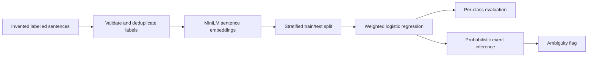

# Case study 02 — Financial Event Classification

This standalone **engineering extract** shows a supervised classifier for financial-news event categories. The original work separated a pretrained sentence encoder from a scikit-learn logistic-regression head; this adaptation keeps that approach, alongside dataset validation, provenance weighting, model-label validation and quantitative evaluation. It does **not** include the larger ingestion system, live news text, or LLM orchestration.

## Problem and method

Financial statements can mention acquisitions, spending, restructuring and company announcements without actually reporting the same kind of event. Basic keywords often produce false positives, particularly where the word *investment* refers to an investment manager rather than capital expenditure.



- **Embedding encoder:** `sentence-transformers/all-MiniLM-L6-v2`, a separately pretrained language model. This sample **does not fine-tune** the transformer.
- **Fitted model:** scikit-learn multinomial logistic regression, `C=1.0`, `max_iter=1000`, fixed random seed 42.
- **Training data:** 72 explicitly **invented** labelled event statements across nine classes; 18 separately authored statements for independent evaluation. Neither fixture is an actual newspaper excerpt or a sample from the original confidential corpus.
- **Weights:** rows marked synthetic receive a 0.75 multiplier; rewritten rows get another 0.9 multiplier; weak capex labels receive another 0.6. This mirrors the private trainer's provenance-aware rules.
- **Train/test selection:** 20% stratified holdout by default; optional group-aware split keyed by source ID, with validation that every class remains present in training. Fixing the seed ensures reproducibility; it does not establish generalisability.
- **Prediction:** derive the winning label from the fitted estimator's `classes_`, return its **uncalibrated predicted probability**, and mark predictions below the default 0.52 threshold as ambiguous. No external LLM request is made.

## Worked classification example (illustrative)

The [synthetic training labels](../examples/synthetic_event_labels.jsonl) include *“Alder Coast Research will invest in a new battery manufacturing facility.”* annotated as `capex_investment`. That is a **human-authored fixture label**, not evidence that the trained classifier predicts it correctly. Once a local model is fitted, its inference result contains a predicted `event_type`, an **uncalibrated** `probability` and an `ambiguous` flag. For example, **if** its top score were `0.47` (hypothetical, not measured), the default `0.52` threshold would set `ambiguous=True`; a score of `0.65` would not. Actual class and score must be obtained by running the local training and inference commands below. Do not present these hypothetical scores as evaluation results.

## Reproduce with synthetic data

```bash
python -m pip install -e '.[ml]'
python scripts/train_event_classifier.py --data examples/synthetic_event_labels.jsonl
python scripts/classify_event.py 'The company approved investment in a new factory.'
python scripts/evaluate_event_classifier.py --data examples/unseen_event_examples.jsonl
```

The first run may download the public MiniLM encoder from Hugging Face (internet access required). **No pretrained weights or trained `.pkl` file are committed.** Only load model pickle files you have generated yourself; loading untrusted pickle files can execute arbitrary code.

The default CI/unit-test workflow runs without the encoder and with a fake classifier; optional tests exercise the actual scikit-learn training logic when it is installed. A successful offline test run is **not** evidence that the transformer is downloadable or a model was trained end to end.

The synthetic experiment will generate its *own* metrics under `artifacts/event_classifier/evaluation.json` (ignored by Git). These results describe the synthetic demonstration only. An additional evaluation on the 18 independently authored statements reports per-class precision/recall/F1 and a confusion matrix; the small size means statistical uncertainty is large.

## Interpretation and limits

This demonstration reports precision, recall and F1 on small **synthetic** fixtures. It does not establish performance on real financial reports. Model probabilities are not calibrated certainty; the ambiguity threshold is a routing heuristic. Stratified random splits may permit near-duplicate or source-family leakage, so the optional group-aware split and a separately adjudicated real-world test set would be required for stronger claims.

## Evidence map

| Engineering competency | Inspect |
| --- | --- |
| Data quality and provenance | [`dataset.py`](../src/osint_research/information_extraction/dataset.py) |
| Transformer sentence embeddings | [`embeddings.py`](../src/osint_research/information_extraction/embeddings.py) |
| Supervised classifier, label handling | [`training.py`](../src/osint_research/information_extraction/training.py), [`labels.py`](../src/osint_research/information_extraction/labels.py) |
| Inference and ambiguity | [`classifier.py`](../src/osint_research/information_extraction/classifier.py) |
| Classification reports and confusion matrix | [`evaluation.py`](../src/osint_research/information_extraction/evaluation.py) |
| Reproducible workflow | [`scripts/train_event_classifier.py`](../scripts/train_event_classifier.py), [`scripts/evaluate_event_classifier.py`](../scripts/evaluate_event_classifier.py) |
| Validation without model download | [`tests/information_extraction/`](../tests/information_extraction/) |

## Scope of adaptations

The source was refactored to remove external parser imports, geographical taxonomy dependencies, business-specific training and operational datasets, ingestion orchestration, and external AI APIs. The event taxonomy is preserved explicitly. Inference verifies `head.classes_` so future model refits cannot silently change labels. Do not treat this case study as a copy of an entire deployed production pipeline.
