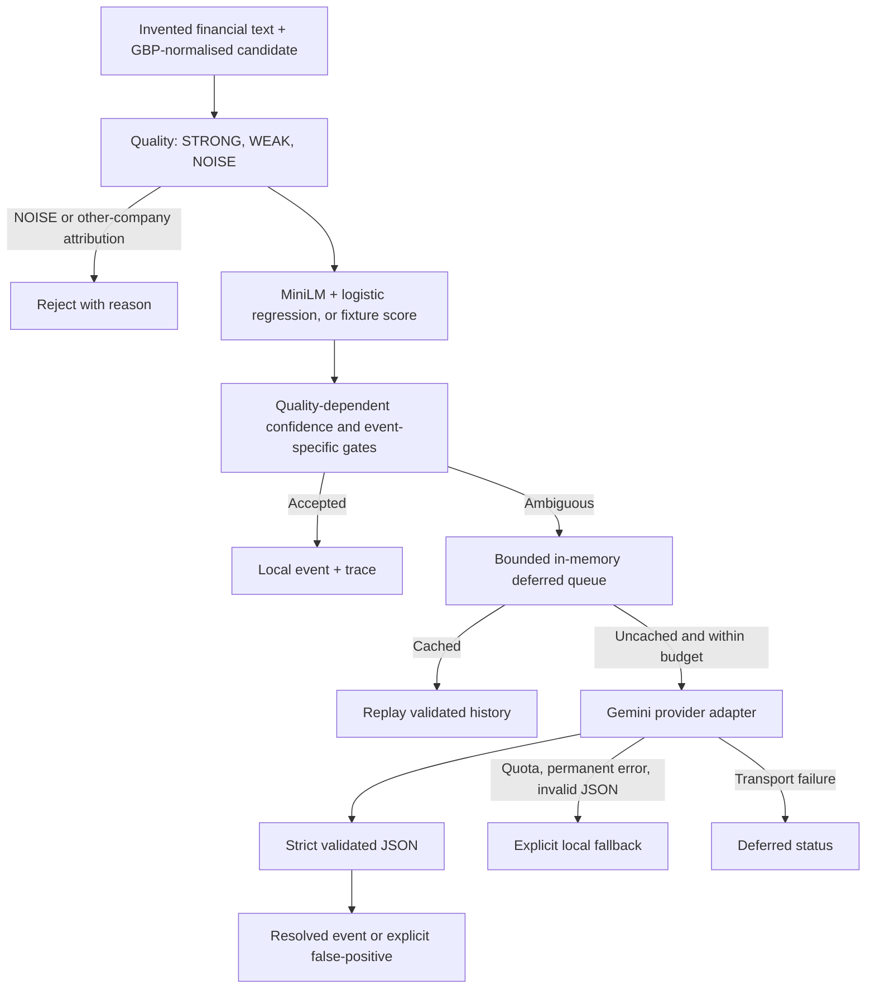

# Case study 03 — Confidence-Routed LLM Enrichment

**Selective Gemini enrichment, transparent decisions, and failure-aware local recovery.**

This is a standalone, **adapted technical showcase** of a three-tier financial-text extraction architecture. It demonstrates decision routing and provider resilience rather than reproducing a commercial ingestion product. The examples are entirely invented. The *offline* mock does not perform actual inference or contact Google's APIs.

## Architecture



### Design decisions and source evidence

| Competency | Code |
| --- | --- |
| Limited GBP regex candidate detection | [candidate_detection.py](../src/osint_research/llm_orchestration/candidate_detection.py) |
| Quality scoring | [candidate_quality.py](../src/osint_research/llm_orchestration/candidate_quality.py) |
| Confidence and event-specific gates | [routing.py](../src/osint_research/llm_orchestration/routing.py) |
| Queue cap, priority and stable cache keys | [queue.py](../src/osint_research/llm_orchestration/queue.py) |
| Typed structured JSON, alias handling and strict labels | [schemas.py](../src/osint_research/llm_orchestration/schemas.py) |
| Mock and optional real Gemini SDK | [providers.py](../src/osint_research/llm_orchestration/providers.py) |
| Quota budget, retries and orchestration | [enrichment.py](../src/osint_research/llm_orchestration/enrichment.py) |
| Truthful failure-status marking | [fallback.py](../src/osint_research/llm_orchestration/fallback.py) |
| End-to-end decision trace | [demo_llm_orchestration.py](../scripts/demo_llm_orchestration.py) |

### Confidence gates

STRONG candidates (at least £1m, 40-character sentence, financial cue) normally use **0.45** as the local acceptance threshold. WEAK candidates (at least £500k but missing a strong criterion) use **0.55**. The **model-backed** `classify_and_route()` path applies cheap quality and other-company attribution gates **before** calling the classifier; NOISE and explicitly unrelated-company candidates are rejected without model inference or LLM processing. The fixture-only `route()` path applies the same rejection rules to a supplied mock prediction (and never invokes the classifier). Amounts supplied here are already normalised into GBP.

An event-specific gate can accept some capex and executive-pay mentions below the general threshold if attribution and additional evidence qualify. The thresholds are **uncalibrated routing heuristics**, not empirical probability guarantees. The isolated financial classifier in [Case Study 02](financial_event_classification.md) has its own generic ambiguity indicator (0.52); this new router takes the underlying score directly and applies the relevant quality-dependent policy. It does not use both thresholds to decide escalation.

The queue **deduplicates before** applying its limit of five **unique events** per source. Duplicate identity includes source, subject company number/name, sentence, supporting context and local predicted event type; a confidence-only difference selects the highest-confidence copy while preserving a separate `DUPLICATE_QUEUE_ITEM` result for every suppressed input. Different companies mentioned in the same sentence stay distinct. Overflow of unique events is recorded as `QUEUE_CAP_PROMOTED` (local prediction used without Gemini). Deterministic priority and an in-memory history cache minimise repeated provider requests. A result obtained from cached prior classifications is labelled `history_cache`, and a local fallback is never labelled Gemini success.

**Cache correctness:** Keys hash the source identity, company and text/context, provider, effective provider model, **local predicted event type**, classifier version and prompt-policy version. The event type matters because responses without `metric_type` inherit the local prediction. A changed event type, model, provider or version causes a fresh enrichment; identical context safely reuses a validated response. Confidence alone does not change the provider payload or parser fallback, so it is not part of the key. `EnrichmentRunner.classifier_version` can be set to the identifier of a new trained-head artifact; bump `PROMPT_POLICY_VERSION` when changing the live prompt or response interpretation. The cache is in-memory only, and does not claim automatic detection of updated model weights or prompt changes.

### Worked routing example (synthetic)

The [`low-value` case](../examples/synthetic_routing_cases.json) describes an invented £12,000 office-supplies purchase. This falls below the £500,000 threshold, so `route()` returns `rejected` with `NOISE_VALUE_BELOW_MIN` even if the fixture contains a low-confidence local prediction. If a real locally trained classifier is supplied through `classify_and_route()`, the **new early gate avoids calling it at all**. The [`ambiguous` case](../examples/synthetic_routing_cases.json), by contrast, is an invented £75 million mention with a fixture confidence of 0.37; it is WEAK, falls below the 0.55 acceptance threshold and can enter the bounded enrichment queue. These values are predetermined fixture inputs, **not measured model outputs**.

### Mocked quick start (no API key, weights, or network required)

```bash
python -m pip install -e '.[dev]'
python -m pytest -q tests/llm_orchestration
python scripts/demo_llm_orchestration.py
python scripts/demo_llm_orchestration.py --scenario ambiguous
python scripts/demo_llm_orchestration.py --scenario invalid
python scripts/demo_llm_orchestration.py --scenario false-positive
```

To pass your own invented GBP-denominated sentence through the *real locally trained* event model and the existing routing gates, use:

```bash
python scripts/demo_llm_orchestration.py --trained-head artifacts/event_classifier/event_head.pkl \
  --text "Alder Renewables invested £240 million in a new factory." \
  --company "Alder Renewables" --company-number "00000001"
```

This small Tier-1 detector extracts the first GBP amount, checks financial words and notes whether the subject's exact name appears. It does **not** resolve pronouns, identify the principal amount across multiple events, or establish definitive legal attribution. Such cases need broader ingestion logic.

The default uses predetermined event labels and probabilities from [synthetic_routing_cases.json](../examples/synthetic_routing_cases.json), not the historical ML model. [mock_gemini_responses.json](../examples/mock_gemini_responses.json) supplies deterministic outputs or simulated errors.

To use the actual locally trained Case Study 02 head instead of fixed probabilities, pass `--trained-head artifacts/event_classifier/event_head.pkl` (only after training it locally). This requires the `ml` extra and may download MiniLM the first time. Only load trusted pickle artifacts generated by you; untrusted pickle data is executable.

**Optional live Google Gemini (not executed in CI):**

```bash
python -m pip install -e '.[gemini]'
export GEMINI_API_KEY=YOUR_KEY_FROM_YOUR_LOCAL_ENVIRONMENT
python scripts/demo_llm_orchestration.py --provider gemini --allow-live --scenario ambiguous --max-calls 2
```

Live calls cost quota and may incur charges. Keep credentials outside files, version control and logs. Do not send confidential content to external providers. The optional live provider is an adapter, not evidence that these invented demonstrations were validated on the Google service.

### Failure matrix

| Situation | Final state | Provenance |
| --- | --- | --- |
| High-confidence local | `local` | `LOCAL_CONFIDENCE_ACCEPTED` |
| Ambiguous + valid mock Gemini | `gemini` | `GEMINI_VALIDATED`, provider `mock_gemini` |
| Same inputs after validated run | `gemini` | `CACHE_REPLAY`, provider `history_cache` |
| Quota exhausted | `fallback_local` | `QUOTA_DEGRADED_FALLBACK` |
| Permanent request failure | `fallback_local` | `PERMANENT_REQUEST_FALLBACK` |
| Malformed or semantically invalid provider response | `fallback_local` | `INVALID_PROVIDER_OUTPUT_FALLBACK` |
| Missing Gemini configuration, authentication failure, or SDK programming error | Raised to caller | `ProviderConfigurationError` or original exception/traceback; never mislabeled as invalid JSON |
| Transport timeout | `deferred` | `TRANSPORT_DEFERRED` |
| Per-run budget exhausted | `fallback_local` | `RUN_BUDGET_EXHAUSTED` |
| Expected classifier inference outage | `degraded_pending` | `CLASSIFIER_EXCEPTION` with safe cause type; not automatically queued |
| Unexpected implementation error or malformed model result | Raised to caller | Preserves the original exception/traceback for diagnosis; no false fallback |
| Queue-cap overflow | `queue_cap_local` | `QUEUE_CAP_PROMOTED` |
| Provider flags false-positive | `rejected` | `GEMINI_FALSE_POSITIVE` |

The enrichment runner catches only explicit quota, transport, or permanent provider failures around the provider request. JSON parsing and Pydantic validation have their own limited fallback boundary, so configuration and programming exceptions propagate rather than becoming `INVALID_PROVIDER_OUTPUT_FALLBACK`. The optional live Gemini adapter reads typed `google.genai.errors.APIError.code` values (instead of guessing from error-message text), translates network failures to transport errors, and chains the original cause. Missing credentials, missing SDK dependencies, and authentication failures remain explicit configuration errors. These conventions are exercised with offline stubs, not paid API requests.

The classifier adapter degrades **only** when the inference implementation raises `InferenceUnavailableError` (for example, when its encoder or probability backend raises `OSError`). Its chained exception preserves the original cause for trusted diagnostic tooling; output status and log messages include only the exception class and source identifier, not private model errors or input text. Unexpected `RuntimeError`, `ValueError`, or malformed predictions propagate instead of being misreported as recoverable model outages.

### Limitations and exact claims

The original implementation uses persistent PostgreSQL queue records, detailed geographical overrides, historical replay, rate-limit governance, per-source queue caps and a distinct database promotion step. This **isolated case study uses an in-memory queue** and does not claim restart durability or production throughput.

The strict event taxonomy and geography validation are showcase hardening beyond the original's more permissive Pydantic contract. The mock simulates the provider rather than judging whether a synthetic statement is semantically correct. No LLM accuracy, cost saving or latency figures are claimed.

Audit the policy and failure tests in [tests/llm_orchestration](../tests/llm_orchestration). They do not access a live API, download model weights or rely on private datasets.
